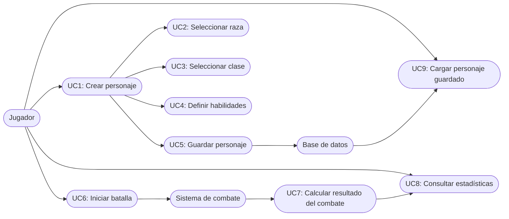

# Codigo-de-Combate

A partir de la estructura del repositorio y de las entidades que aparecen, el sistema “Codigo-de-Combate” parece ser un gestor de personajes y combates para un juego o simulador RPG/arena. No es una app web completa visible a simple vista, sino más bien una base de lógica de dominio y persistencia.

## Qué maneja el sistema

- Gestión de personajes:
  - La entidad Personaje tiene nombre, raza, clase, nivel, experiencia y habilidades.
  - Las habilidades incluyen combate, punteria, agilidad, fuerza, resistencia y estilo.
- Tipos de personajes:
  - Hay entidades específicas como Arquero, Asesino, Guerrero y Mago.
  - Eso sugiere que un jugador puede elegir o asignar una clase de combate.
- Gestión de batallas:
  - Existe la entidad Batalla.
  - Esto indica que el sistema también contempla enfrentamientos, turno o cálculo de resultado.
- Persistencia:
  - Hay capas de Persistencia con repositorios, entidades y conexión a MySQL.
  - Se usan MySqlConnectionFactory e IDbConnectionFactory, por lo que los datos se guardan en base de datos.
- Scripts SQL:
  - Hay script1.sql y script2.sql, lo que refuerza la idea de creación/uso de base de datos.
- Pruebas:
  - Hay pruebas ServicioATests.cs y ServicioBTests.cs, así que la lógica de negocio está pensada para validarse en servicios.

## Flujo principal del sistema

1. El jugador crea o carga un personaje.
2. Define su raza, clase, nivel y experiencia.
3. Asigna sus habilidades de combate.
4. El sistema valida/guarda esos datos en la base de datos.
5. El personaje participa en una batalla.
6. El sistema calcula resultados según habilidades, clase y estado.
7. La información quedará persistida para futuras partidas o consultas.

## Diagrama de casos de uso (versión textual)

Actor principal:
- Jugador

Actores secundarios:
- Sistema de combate
- Base de datos

Casos de uso:
- UC1: Crear personaje
- UC2: Seleccionar raza
- UC3: Seleccionar clase
- UC4: Definir habilidades
- UC5: Guardar personaje
- UC6: Iniciar batalla
- UC7: Calcular resultado del combate
- UC8: Consultar estadísticas del personaje
- UC9: Cargar personaje guardado

Diagrama Mermaid:

Diagrama en texto:

Jugador
  |---> UC1: Crear personaje
  |---> UC2: Seleccionar raza
  |---> UC3: Seleccionar clase
  |---> UC4: Definir habilidades
  |---> UC5: Guardar personaje
  |---> UC6: Iniciar batalla
  |---> UC8: Consultar estadísticas
       v
Sistema de combate
  +--> UC7: Calcular resultado del combate
  +--> UC9: Cargar personaje guardado
       v
Base de datos
  +--> Persistir personaje
  +--> Persistir batalla
  +--> Recuperar datos

Versión más UML-like:

[Jugador]
  | crear personaje
  v
[UC1: Crear personaje] ----> [UC2: Seleccionar raza]
  |                       |
  |                       --> [UC3: Seleccionar clase]
  |                       |
  |                       --> [UC4: Definir habilidades]
  |                       |
  |--> [UC5: Guardar personaje] ----> [Base de datos]
  |
  |--> [UC6: Iniciar batalla] ----> [UC7: Calcular resultado]
  |
  |--> [UC8: Consultar estadísticas]

## Resumen corto

El sistema parece ser un “administrador de personajes y combates” donde el usuario crea personajes con atributos y habilidades, y luego puede enfrentarlos en batallas con lógica basada en esas estadísticas. La arquitectura está dividida en capa de aplicación, persistencia y pruebas, con almacenamiento en MySQL.

Si quieres, puedo convertir este mismo análisis en un diagrama más formal tipo UML con formato de texto listo para pegar en Word o PowerPoint.
